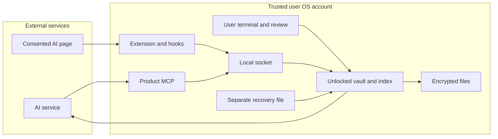

# Growth Brain threat model — 2026-11-04

## Executive summary

현재 제품은 사용자 기기의 암호화 금고와 로컬 IPC를 신뢰 기반으로 삼는다. 주요 위험은 열린 금고에 접근하는
동일 OS 사용자 프로세스, 수집/승인된 내용의 의미 오염, 범위·최신성 오류, 복구 자료의 노출과 삭제 범위다.
이번에 입증한 잠금 지연과 전환 백업 잔존은 medium 2건이며 수정·회귀 검증했다.
그 외는 잔여 위험/검증 과제이며 확인된 취약점으로 집계하지 않는다. 실제 사용자 기기·AI·원격 서버 전체를 감사한 보고서가 아니다.

## Scope and assumptions

근거: `src/{vault,envelope,broker,mcp,native-host,agent-hook,engine,model,memory-index}.ts`, `extension/`,
설치용 `scripts/`, 해당 테스트. Node24/TypeScript, MCP SDK1.32.2, Chrome MV3, Python 설치기이다.
시작 기준은 c57e60e, 챕터21 잠금 수정 f85df46, 삭제 수정은 이 보고서와 같은 챕터22다.

사용자가 이미 명시한 경계를 재사용한다: 실제 금고는 사용자 기기에서 열고 검색한다; 서버에는 암호문만 저장해야 한다;
AI에 전달한 맥락은 해당 AI가 읽는다; 현재 요청 > 프로젝트 > 공통; 승인되지 않은 기록은 현재 맥락이 아니다;
개발 클라우드는 사용자 기기가 아니다. 이번 사용자 추가 설명은 인터뷰4명/합성고객 자료/미확정 고객군과 맥락 인계 우선이다.
확정된 배포·보안 맥락은 다시 질문하지 않았다. 데이터는 고객별 전략·개인 선호·대화·출처 등 민감할 수 있다고 평가한다.

현재 앱 런타임의 공개 HTTP 금고 API를 발견하지 않았다. Unix socket 기반이고 로컬 OS 계정은 신뢰 대상이다.
root/악성 동일 사용자 프로세스/디버거, 메모리 덤프, SSD 안전 소거 방어는 제공하지 않는다.
원격 동기화·계정 삭제·Supabase 현행 RLS, 고객 기기 운영체제별 보호, 실환경 설치는 범위 밖 또는 차단 상태다.
서버 SQL 파일의 존재를 실제 적용/안전성 근거로 삼지 않는다. 개발 ign8t와 GitHub는 제품 기억 저장 경로가 아니다.

위험도를 바꿀 열린 질문: 실제 고객이 쓰는 OS/AI 클라이언트, 공유 계정·장치 사용 여부, 원격 서비스의 현재 Auth/RLS와 삭제 계약,
백업을 복제하는 OS/클라우드 설정. 해당 답 없이 원격 서비스의 안전성이나 비개발자 설치 적합성을 승인하지 않는다.

## System model

### Primary components

`cli.ts`는 TTY 전용 비밀 입력·CONNECT/승인/삭제 확인, `vault.ts`는 단일 쓰기 큐·키·암호문 파일,
`envelope.ts`는 scrypt/AES-256-GCM 및 복구 슬롯, `engine.ts`/`memory-index.ts`는 승인 상태와 RAM 색인이다.
`mcp.ts`는 3개 제품 도구만 등록한다. `broker.ts`는 native/로컬 검토용 작업도 허용하므로
MCP에 승인 도구가 없다는 사실만으로 적대적인 로컬 프로그램의 승인 우회가 방지되지는 않는다.
`native-host.ts`, `agent-hook.ts`, Chrome background/content는 수집 경로다. 설치기와 ign8t 진단은 개발/설정 표면으로 별도다.

### Data flows and trust boundaries

- 사용자 터미널 → 금고: TTY 비밀번호/복구 파일 경로, 사용자 승인. 비밀은 MCP 도구로 받지 않음(`cli.ts::hidden`).
- 잠금 금고 파일 → 열린 RAM 엔진: OS 파일 소유자/비공개 권한/크기/envelope 검증, 인증 복호화, 상태 정합성 검사(`vault.ts`, `envelope.ts`, `model.ts`).
- AI 클라이언트 → stdio MCP → Unix socket: 스키마와 프레임 크기 검증, 0600 socket/0700 디렉터리/같은 OS 소유자. 클라이언트별 별도 인증 경계는 아님(`mcp.ts`, `broker.ts`).
- RAM 엔진 → AI 서비스: 승인된 공통 및 선택 프로젝트의 값·출처·이유가 평문 도구 응답으로 전달됨. 수신 서비스의 보유/처리를 로컬 암호화가 통제하지 못함.
- 동의한 페이지 DOM → content → background → native → socket: 선택 사이트·프로젝트·페이지 URL/발신자·동의·메시지 스키마 검증. DOM 내용과 AI 응답의 진실성은 신뢰하지 않음(`extension/background.js`, `src/engine.ts::capture`).
- 클라이언트 훅 → 어댑터 → socket: 정확한 workspace/client/project 및 consent generation, prompt/answer 대응 검사. 원문은 암호화 저장, 추출은 후보(`agent-hook.ts`, `engine.ts::captureAgent`).
- 금고 → 디스크/수동 백업: 저장별 새 nonce의 인증 암호문, 원자적 파일 교체. 별도 복구 파일은 백업을 해제하는 비밀이며 평문 파일 권한·분리 위치로 보호(`vault.ts::issueRecovery`).
- 개발자/공개 스킬 → 소스/Git: 고정 원문/라이선스와 blob 검사. 자동 실행 금지. ign8t는 안전 환경 바인딩을 통해 개발 명세만 조회(`scripts/verify-skills.mjs`, `scripts/ign8t-doctor.mjs`).

#### Diagram

서버 동기화는 현재 검증된 경로에 없으므로 그림에서 작동하는 구성요소로 표시하지 않았다.

## Assets and security objectives

| Asset | Why it matters | Security objective (C/I/A) |
| --- | --- | --- |
| 프로젝트 이름·대화·기억·출처·색인 | 고객별 민감한 업무 맥락 노출 방지 | C |
| 승인·대체·폐기·라우팅·인계 상태 | 잘못된 조건으로 업무를 수행하거나 다른 고객 맥락이 섞이지 않게 함 | I |
| 비밀번호·데이터 키·개인 복구 파일 | 현재/과거 암호문 접근 권한 | C/I |
| 금고·전환/수동 백업·잠금 | 장애 후 복구와 의도한 삭제, 손상/중복 실행 방지 | A/I/C |
| 설치 설정·고정 의존성·스킬 원문 | 훅·MCP 실행 코드와 개발 공급망 신뢰 | I |

## Attacker model

### Capabilities

AI/페이지는 오해를 부르는 텍스트, 큰 입력, 악성 지시, 틀린 완료 주장을 만들 수 있다. 로컬 클라이언트는 유효/잘못된
socket 프레임과 늦은 요청을 보낼 수 있다. 파일 복사본을 훔친 자는 비밀번호 오프라인 추측을 시도할 수 있다.
개발 의존성/스킬이 바뀌면 개발 도구 실행 경로를 노릴 수 있다. root나 동일 OS 사용자 악성 프로세스는 더 강한 권한을 가지며 신뢰 경계 밖이다.

### Non-capabilities

일반 웹페이지가 곧바로 TTY 잠금 해제/승인 API를 가진다고 가정하지 않는다. 공격자가 AES-GCM을 깨거나 다른 OS 사용자의
0700 디렉터리에 접근한다고 가정하지 않는다. native origin argv는 브라우저 연결 확인이며 같은 OS 악성 프로세스가 위조 불가능한 비밀이 아니다.
인터넷 공격자가 직접 접근할 제품 HTTP 금고 포트는 확인하지 못했다.

## Entry points and attack surfaces

| Surface | How reached | Trust boundary | Notes | Evidence |
| --- | --- | --- | --- | --- |
| TTY/복구 파일 | 사용자가 실행 | 사용자→로컬 키 | 비밀 비표시, 저장소/금고와 복구 파일 분리 | cli.ts::hidden, vault.ts::recoveryDestination |
| 암호문/상태 | open/restore/recover | 디스크→엔진 | 인증/소유자/포맷/정합성 검사 | envelope.ts::decrypt, model.ts::parseState |
| 제품 도구/IPC | stdio/socket | AI→승인된 맥락 | 명시적 schema/크기/오류 코드, 같은 OS 권한 | mcp.ts, broker.ts::requestSchema |
| 페이지 수집/검토 | 선택 사이트/확장 popup | DOM→금고 후보 | content는 관리 작업 불가, popup 발신자 요구 | extension/background.js::dispatch |
| agent hook payload | 승인된 훅/어댑터 | 세션→프로젝트 | workspace/consent generation/turn 검사 | agent-hook.ts, engine.ts::captureAgent |
| 설치/의존성/스킬 | 개발자 명령 | 공개 코드→기기 | 사용자 설정 보존, 원문 고정; 코드 실행 자체의 신뢰는 별도 | scripts/agent-hooks.py, vendor/skills/sources.json |

## Top abuse paths

1. 잠금 후 조회: 기존 연결에서 partial 요청 대기 → 사용자가 lock → 나중에 프레임 완성 → 이전 구현에서 조회/종료 지연. GB-LOCK-01로 재현·수정.
2. 삭제 후 과거 복원: 이전 상태 파일 열기 → 자동 전환 백업 생성 → delete-all → 남은 백업+기존 자격으로 과거 프로젝트 복구. GB-DELETE-01로 재현·수정.
3. 의미 오염: 대화에 악성 지시나 잘못된 완료 주장 포함 → 후보 생성 → 사용자가 잘못 승인 → 다음 AI가 사실/지시로 사용. 후보 승인·출처는 완화책이며 진실성 검증은 아님.
4. 범위/최신성 혼동: 모호한 트리거·상충 결정·늦은 수집을 입력 → 다른 프로젝트나 이전 결정을 현재 인계로 사용하도록 유도. 현행 격리 테스트는 있으나 작업 인계 최신성 전용 구현은 남음.
5. 열린 기기 접근: 같은 OS 사용자 프로그램 실행 → socket 직접 호출/프로세스 접근 → 원문/검토 조작. 명시된 신뢰 경계이며 앱 간 샌드박스가 아님.
6. 복구 자료 노출: 암호문 백업과 대응 복구 파일을 함께 획득 → 과거 상태 복호화. 별도 오프라인 보관·재발급은 미래 복사본에 적용되고 과거 복사본은 회수하지 못함.
7. 공급망 오염: 변경된 다운로드/설치 스크립트를 실행 → 사용자 설정이나 로컬 파일 접근. 고정 원문은 자동 실행하지 않고 패키지 lock/리뷰를 유지해야 함.
8. 수집/메시지 폭주: 많은 로컬 native/socket 요청을 전송 → 처리 대기·프로세스 자원 소비. 단일 프레임/금고 한도는 있으나 전체 연결 수·누적 대기열 부하 검증은 미완료.

## Threat model table

| Threat ID | Threat source | Prerequisites | Threat action | Impact | Impacted assets | Existing controls (evidence) | Gaps | Recommended mitigations | Detection ideas | Likelihood | Impact severity | Priority |
| --- | --- | --- | --- | --- | --- | --- | --- | --- | --- | --- | --- | --- |
| TM-001 | 늦은 로컬 peer | 열린 socket | lock 후 요청 완성 | 조회/종료 지연 | 맥락·가용성 | broker/cli의 즉시 closing+disconnect 수정 | 잠금 전 수신 내용 회수 불가 | 회귀 유지 | 응답 내용 없는 종료시간 측정 | medium: 정상 지연 peer도 가능 | medium: 잠금 의도 위반 | medium |
| TM-002 | 남은 백업 보유자 | 이전 금고 전환+자격 보유 | 삭제 후 과거 복원 | 잔존 데이터 | 이전 기억 | vault.ts::deleteAll 관리 백업 검사/삭제 수정 | 수동/외부 복사본 별도 | 삭제 범위 안내·별도 복사본 관리 | 파일 수/성공 여부만 확인 | medium: 전환 사용자는 흔히 생성 | medium: 암호문과 자격 필요 | medium |
| TM-003 | 페이지/AI/승인 실수 | 악성 내용이 승인됨 | 기억을 지시/확인 사실로 사용 | 잘못된 인계·업무 | 결정/작업 상태 | engine review/출처, mcp 후보 전용 | 의미 진실성·작업 완료 증거 미검증 | 인계 스키마/근거/최신성 및 실제 AI 대항 사례 | 승인 취소·오류 분류, 원문 무로그 | medium: 모델 오류/과신 가능 | high: 고객 업무 오판 가능 | high |
| TM-004 | 입력/동시성 오류 | 여러 프로젝트/세션 | 오라우팅·이력 부활 | 고객 간 맥락 혼입 | 프로젝트 경계 | engine/model/index 상태 필터·명시 대체·ambiguous common only | 실클라이언트/전용 인계 미검증 | 실제 두 프로젝트 인계 검증 | 합성 sentinel·범위 불변식 | low: 구현과 회귀로 완화 | high: 고객 정보 잘못 전달 | medium |
| TM-005 | 동일 OS 악성 프로세스 | 기기/계정 장악 | 열린 socket 직접 접근 | 읽기/검토 조작 | 키·모든 로컬 맥락 | OS 권한, 사용자 고지, 수동 lock | 앱별 격리/idle lock 없음 | 사용자 기기 잠금·신뢰 계정; 필요 시 별도 OS격리 설계 | 비밀 없는 실행/잠금 상태 | conditional: 계정 장악 전제 | high: 열린 금고 전체 | high |
| TM-006 | 복사본 절취자 | 백업+복구파일 또는 약한 암호 | 오프라인 복호화/추측 | 과거 기억 노출 | 복구 키·백업 | envelope AEAD/scrypt, 분리위치, 재발급 | 과거 키/복사본 회수 불가 | 보관/복구 안내·실기기 복구 연습 | 파일 내용 없는 보관 확인 | low: 함께 획득해야 함 | high: 대응 스냅샷 전체 | medium |
| TM-007 | 개발 공급망 | 개발자가 코드 실행 | 훅/설치기 오염 | 기기/설정 손상 | 실행코드·비밀 | pinned skills/lock/설정보존 테스트 | advisory0은 무결성 보증 아님 | 원문 코드 검토·자동 실행 금지 유지 | blob/hash·diff 검사 | low: 실행 권한 필요 | high: 같은 사용자 권한 실행 | medium |
| TM-008 | 로컬 요청 폭주 | native/socket 접근 | 많은 프레임/연결 | 자원 소모 | 가용성 | request64KiB/response256KiB/native frame1MiB/금고16MiB | 전체 연결/대기열 상한 검증 없음 | 실제 필요 부하 측정 후 전역 한도 | 내용 없는 queue/메모리 수치 | low: 로컬 접근 전제 | medium: 프로세스 재시작 | low |
| TM-009 | 원격 계정 경계 실패 | 향후 동기화 사용 | 타 회원 읽기/삭제 누락 | 서버 암호문/계정 노출 | 원격 데이터 | 암호문 전용 요구사항 | 현행 Auth/RLS/삭제 미검증 | 실제 스키마 읽기→격리/삭제 검증 전 원격 출시 차단 | 테스트 계정의 정책 검사 | unknown: 현재 경로 미검증 | high: 다중 계정 영향 가능 | high |

high 항목은 수정되지 않은 확정 취약점 숫자가 아니다. 명시된 기기 신뢰 경계와 향후 출시/인계 검증의 우선순위다.
민감한 원문·키·프로젝트 이름을 탐지 로그에 추가하지 않는다. 무료·유료 계층의 보호 차이는 허용하지 않는다.

## Criticality calibration

critical: 인터넷 비인증 사용자가 모든 금고를 복호화하거나 복구 키를 대량 유출하는 경로(현재 입증 없음).
high: 다른 고객 맥락의 실제 유출, 승인 경계를 넘어 잘못된 완료/결정이 자동 확정되는 경로. 같은 OS 완전 장악은 영향은 크지만 현재 방어 약속 밖이다.
medium: 잠금 중 접근 지속, 앱 관리 암호문 백업 삭제 누락처럼 로컬 조건/자격이 필요한 개인정보 수명주기 오류.
low: 안전한 실패의 잘못된 안내, 로컬 사용자의 제한적 자원 소모처럼 직접 정보 노출 없이 복구 가능한 문제.
이는 이 저장소의 기준 예시이며 모두가 발견됐다는 뜻은 아니다.

## Focus paths for security review

| Path | Why it matters | Related Threat IDs |
| --- | --- | --- |
| src/vault.ts, src/envelope.ts | 키·복구·직렬 쓰기·삭제 범위·파일 경계 | 001,002,005,006 |
| src/cli.ts, src/broker.ts | 잠금 순서·연결 정리·검토 API의 OS 신뢰 | 001,005,008 |
| src/model.ts, src/engine.ts, src/memory-index.ts | 승인·대체·폐기·프로젝트 라우팅과 인계 의미 | 003,004 |
| src/mcp.ts | 외부 AI에 전달되는 데이터·출력 계약 | 003,004 |
| extension/background.js, extension/content.js, extension/popup.js | 동의/페이지 이동/검토·출처 렌더링 | 003,004 |
| src/native-host.ts, src/agent-hook.ts | 프레임·workspace/turn·대기열 | 004,008 |
| scripts/, package-lock.json, vendor/skills/sources.json | 설정 보존·고정 실행 코드/참고자료 | 007 |
| docs/implementation-spec.md, docs/requirements-2026-11-03.md | 원격 요구와 현재 미검증 상태의 차이; 실제 서버 스키마/정책은 안전 연결 후 별도 검사 | 009 |

## Notes on use

진입점·각 신뢰 경계·개발/runtime 구분·사용자 제공 맥락·미확인 서버 조건을 위에 명시했다.
재현/수정/검사 결과는 [security-lifecycle-review-2026-11-04.md](security-lifecycle-review-2026-11-04.md).
검토 범위에서 추가 critical/high 공격 경로를 입증하지 못했다는 사실은 제품 전체의 무취약성 결론이 아니다.
향후 작업 인계 상태나 원격 동기화가 추가되면 이 모델과 합격 사례를 함께 갱신한다.
