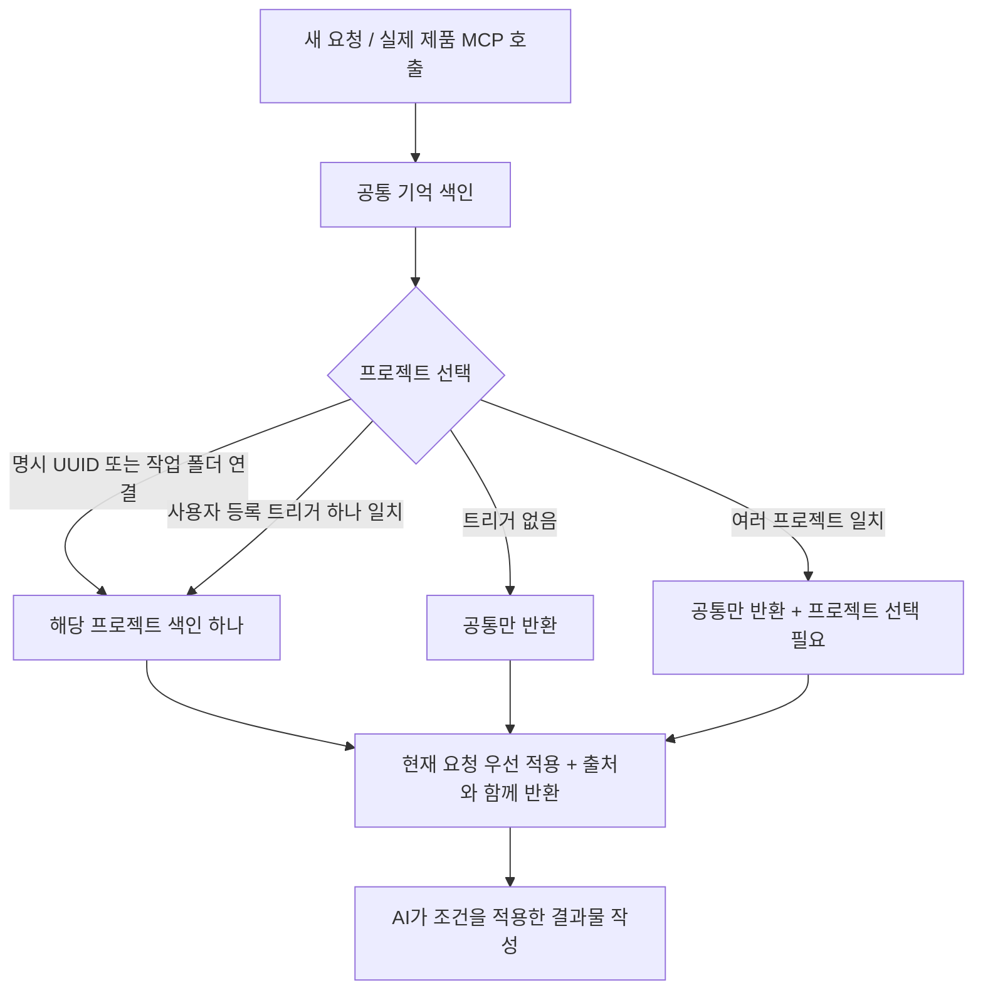

# 공통 기억과 프로젝트 색인

사용자 기기의 암호화 금고 하나 안에 공통 저장소와 프로젝트별 저장소를 논리적으로 분리한다.
조회는 항상 공통이 출발점이다. 공통을 먼저 읽지만 우선순위는 **현재 요청 > 선택된 프로젝트 > 공통 기본값**이다.

## 선택과 트리거

- `get_context({})`는 프로젝트를 추측하지 않고 공통만 반환한다.
- `get_context({projectId})`는 공통을 읽은 뒤 해당 프로젝트를 적용한다. 훅의 사용자 작업 폴더
  연결도 이 명시적 선택이다. 경로만 보고 프로젝트를 추측하거나 하위 폴더에 동의를 상속하지 않는다.
- `get_context({query: "오로라 캠페인"})`는 사용자가 등록한 키워드에만 대응한다.
  한 프로젝트면 `configured_trigger`, 여러 프로젝트면 `project_selection_required`와 후보 UUID를
  반환한다. 후자의 경우 어느 프로젝트 기억도 반환하지 않는다. 명시 UUID가 트리거보다 우선한다.
- 별도 사용자 터미널의 `route-set`에서 프로젝트 UUID와 쉼표로 구분한 키워드를 입력하고
  `ROUTE`로 저장한다. `routes`는 확인, `route-clear`는 해당 프로젝트의 트리거 해제다.
  MCP와 페이지에는 트리거 관리 권한이 없다. 설정은 금고 안에서 암호화한다.
- 라틴 문자 트리거는 단어 경계를 검사하고, 한글 등은 정규화된 부분 문자열을 사용한다.
  등록한 키워드가 인용문에 등장해도 일치할 수 있다. 이 규칙은 의미 판단이나 권한 판정이 아니다.
  특정 작업은 명시 프로젝트를 선택하고, 모호한 일반 단어를 프로젝트 트리거로 등록하지 않는 편이 낫다.

## 검색과 최신성

공통/프로젝트마다 역색인(postings)을 만든다. `search_memory`는 공통과 선택된 프로젝트 하나만
검색한다. 승인된 active 항목만 색인에 들어가며, 프로젝트/현재 요청으로 덮어쓴 key도 순위 계산의
결과 대상에서 제외한다. 후보·반려·대체·사용 중지는 현재 기억으로 나오지 않는다.

챕터26부터 [업무별 적용 조건](preference-applicability.md)을 덮어쓰기/순위보다 먼저 제한한다.
`applicability.taskTypes`가 있는 기억은 현재 `taskType`과 일치해야 하며 업무 생략 시 제외한다.
업무에 해당하지 않는 프로젝트 기억은 공통 기본값을 가리지 않는다. 조건 없는 옛 기억을 자동
재분류하지 않으며, 업무명이나 질의어에서 저장된 승인 조건을 새로 추측하지 않는다.

조건 key/현재 value를 NFKC·대소문자 정규화하고 영어의 제한적 복수형 처리, 한글 글자쌍과
일부 조사 정규화를 적용한다. tone→말투·어조, budget→예산 등 제한된 조건명 별칭도 제공한다.
BM25 기반 점수에 정확한 토큰 일치와 질의어 일치 비율을 반영한다. `score`는 관련도 정렬값이며
정답 확률이 아니다. `matchedTerms`는 어떤 질의어로 검색됐는지 보여준다.

챕터 14에서는 정형 key의 8개 조건에 제한된 한국어/영어 개념 보조를 추가했다.
`matchedTopics`가 그 근거를 표시하며 알고리즘 식별자는 `local-lexical-topic-v2`다.
질문의 개념은 프로젝트 선택이나 기억의 승인 상태를 변경하지 않는다.
[후보 추출·검색의 최신 평가](memory-quality.md)를 참고한다.

변경 사유/출처는 과거의 폐기된 값을 인용할 수 있어 검색 필드로 쓰지 않는다. 일치한 현재 기억의
근거로는 반환한다. 사용 중지/대체된 항목의 역사 검색은 이 API의 목적이 아니다.
승인·교체·사용 중지 후에는 색인을 무효화하고 다음 조회 때 다시 만든다. 후보 수집은 기존
색인을 재사용한다. 쓰기가 실패한 분기에서 변경한 색인이 저장된 현재 엔진에 섞이지 않는다.

색인은 열린 금고 프로세스의 RAM에만 존재한다. 평문 색인 파일·외부 임베딩 요청·서버 검색은 없다.
잠금 시 엔진 참조를 해제하고 재개 시 암호문에서 재생성한다. JS 힙의 문자열 완전 소거를 보장하지는
않는다. 현재 단일 암호문 스냅샷 저장과 10,000개 기억/16MiB 제한은 유지한다.

MCP 응답에는 `searchedScopes`, `routing`, 생략된 개수 `omittedCount`가 있다. AI는 후속 검색에
확정된 프로젝트 UUID와 동일한 `requestConditions`, `taskType`을 매번 전달해야 한다.
`taskExcludedCount`는 선택 범위에서 업무 때문에 제외한 active 기억 수이며 질의 일치/크기 생략 수가 아니다.
모델이 실제 호출하지
않으면 기억을 적용했다고 주장하면 안 된다. 훅은 호출 지시를 제공하며 실제 모델 호출을 보장하지 않는다.

## 재현 가능한 검사와 한계

`npm test`: 공통 단독/명시/트리거/모호함, 우선순위, 상태 제외, 색인 갱신, 실패 롤백, 잠금·재개,
평문 파일 부재와 실제 stdio MCP의 선택/검색을 검사한다. `test:terminal`은 트리거 설정/해제를
실제 PTY에서 검사한다.

`npm run test:search`는 합성 corpus에서 동일한 유효 기억에 대한 단순 문자열 검색과 비교한다.
2026-11-03 현재 17개 양성 질의 중 첫 결과/상위 5개 적중은 각각 15/17(단순 검색 6/17)이다.
다른 프로젝트·미승인·과거·사용 중지·덮어쓴 값에 대한 5개 음성 질의의 노출은 0개다.
5,000개 짧은 기억/100회 검색에서 최초 색인 포함 약 74ms, 준비 후 중앙값 약 0.73ms/p95 약
1.34ms였다. 이 실행기의 단일 합성 측정이며 실사용 정확도나 성능 보장이 아니다.

위 수치는 챕터 12의 기록이다. 당시 놓친 `돈을 얼마나 써도 돼`→예산,
`독자가 행동하게 만드는 문구`→CTA는 챕터 14의 제한된 개념 보조로 찾는다. 최신 확대 평가에서는
45개 양성 중 43개를 첫 결과로 찾고, 음성 15개는 결과가 없다. 개발용 합성 자료다.
일반적인 의미 검색/학습된 임베딩은 아직 없다. 기기 내 의미 검색과 다양한 실제 표현의 평가는 남는다.
현 단계에서 색인 추가만으로 AI 답변의 정확성이나 전체 MVP 합격을 선언하지 않는다.

### 챕터 29: 같은 키의 작업별 변형

범위 색인은 키별로 기본값과 작업별 예외를 보존한다. 일치하는 예외 → 같은 범위의 기본값 순서로 하나를 선택한 뒤 프로젝트 > 공통, 현재 요청 제외 규칙을 적용한다. 검색도 동일한 선택 ID만 반환하므로 낮은 순위의 옛 값이 검색으로 다시 드러나지 않는다. 겹치는 활성 예외는 승인/복원 시 거절한다. 프로젝트 인계는 이 색인과 분리하여 `get_context.handoff`로 제공한다.
