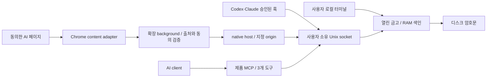

# 로컬 프로토콜·변경 검토

이번 범위에서 확인한 결함 2개를 수정하고 실제 소켓/stdio 검사로 검증했다. 배포 승인이 아니라
챕터 16 변경에 대한 조건부 승인이다. 실제 AI 개인화·사용자 기기 설치·원격 RLS는 아직 미검증이다.

| 심각도 | 확인한 결함 수 | 결과 |
| --- | --- | --- |
| Critical / High | 0 | 이번 범위에서 입증한 항목 없음; 전체 제품 안전성 보증 아님 |
| Medium | 0 | 동일 |
| Low | 2 | IPC 오류 분류/응답 계약·크기 제한 수정 |

## 범위와 신뢰 경계

사용자가 명시한 사용자 기기 암호화 금고, 잠금 해제 후 RAM 검색, 서버 암호문 전용,
AI에 전달한 맥락은 AI 서비스가 읽을 수 있음이라는 전제를 사용했다. 추가 배포 가정을 만들지 않았다.
TypeScript/Node24 Unix socket, MCP SDK1.32.2, vanilla Chrome MV3, Python 설치기이다.
참고 스킬에 vanilla Node IPC 전용 보안 문서는 없으므로 Express/HTTP 규칙을 억지로 적용하지 않았다.
일반 JS frontend 지침, threat-model 경계/자산 지침, differential review의 호출자·과거 변경 검토를 적용했다.

동일 OS 사용자 권한의 악성 프로그램은 열린 socket/프로세스에 접근할 수 있다. MCP에 승인
도구가 없다는 것은 적대적인 동일 사용자 프로세스의 승인 우회를 막는 샌드박스라는 뜻이 아니다.
개발 ign8t에는 개발 명세만 연결하며 금고 내용을 보내지 않는다. 다운로드한 스킬은 개발 참고 자료다.

## 확인한 결함과 수정

**GB-SEC-01 / Low — 크기 오류가 일반 실패로 바뀌고 금고 잠금 해제를 잘못 안내.**
기존 `src/broker.ts:23`의 64KiB 제한은 있었지만 safeError allowlist에는 크기 오류가 없었다.
유효한 requestConditions20개에 한국어2000자씩 넣으면 schema를 통과해도 바이트 제한을 넘는다.
MCP가 REQUEST_FAILED와 일률적인 unlock 안내를 내보내 재시도로 해결되지 않았다.
새 `src/broker.ts:29`은 오류별 다음 행동을 제공하고 `:90`에서 전송 전 바이트를 제한한다.
`src/mcp.ts`가 이 안내를 사용한다. 실제 MCP 검사에서 REQUEST_TOO_LARGE/Reduce 안내와
금고 암호문 불변을 확인했다. 공개 네트워크 공격 경로로 입증된 결함은 아니다.

**GB-SEC-02 / Low — 빈 응답을 성공으로 받음 / 송신 응답 크기 제한 누락.**
기존 callBroker는 `{}`를 성공한 undefined로 처리했고, 서버는 큰 목록을 전송한 뒤에야
클라이언트가256KiB 제한으로 거절했다. `src/broker.ts:112`의 명시적 단일 result/error 계약과
`:72`의 서버 응답 바이트 제한을 추가했다. 요청/응답 버퍼도 합치기 전에 크기를 확인한다.
원문 오류/잘못된 JSON은 안전한 고정 코드만 반환한다. 동일 사용자 socket peer/정상 큰 목록
경로에서 재현했으며 외부 임의 코드 실행이나 암호문 유출로 과장하지 않는다.

## 변경 이력과 영향 범위

`git blame`으로 초기 프로토콜은158e91e, 최신 오류 목록은3693816부터 이어짐을 확인했다.
수정은 broker와MCP의 오류 처리이며 기존 암호화 형식/승인 규칙/동의 조건을 제거하지 않았다.
직접 호출자는 mcp.ts, native-host.ts, agent-hook.ts 세 개다. native/hook은 안전한 오류 코드를
전달하고, 다음 행동 안내 변경은 제품MCP에만 적용된다. response 제한 후 쓰기 성공 여부가
애매할 때 자동 재시도를 유도하지 않는다.

변경 전 두 회귀 검사가 실패했다(잘못된JSON→REQUEST_FAILED, `{}`→잘못된 성공).
수정 후 `npm test`55/55 통과: 실제소켓의 큰 입력/응답·잘못된프레임·잘린응답·비밀문자열 오류,
실제MCP의한도/잠금, native/훅IPC, 암호문/복구/격리 회귀를 포함한다. 라인 커버리지 비율은 측정하지 않았다.

frontend에서는 popup의 textContent/createElement, background의 sender/동의 제한,
manifest의 self script CSP를 확인했다. 원격스크립트/eval/innerHTML 경로를 발견하지 않았다.
실제 설치 확장과 live AI DOM은 정책상 미검증이고, 서버 RLS는 안전한 연결이 없어 검토 범위 밖이다.
